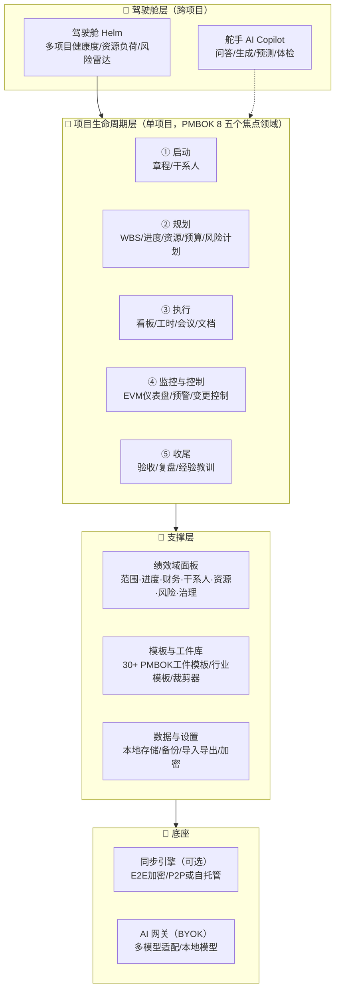
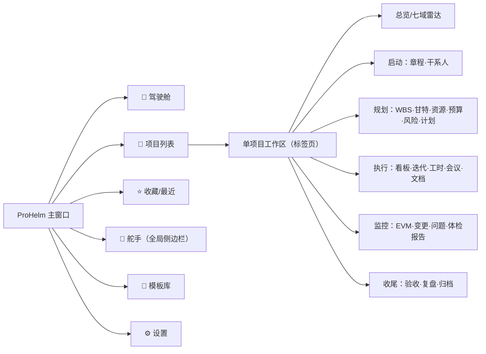
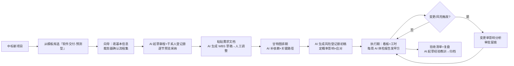

# ProHelm（项舵）产品功能设计

> 版本：v0.1（初稿）｜日期：2026-11-14
> 前置文档：《01-市场调研与PMP体系梳理》｜后置文档：《03-技术选型与架构设计》

---

## 1. 产品定位

### 1.1 定位声明

> **ProHelm（项舵）是一款面向中小团队的桌面端项目管理工具，把 PMP 方法论、AI 舵手和本地优先的数据主权，装进一个轻量应用，帮项目经理"接得住项目、看得清风险、交得出结果"。**

### 1.2 命名与产品隐喻

- **ProHelm** = Professional + Helm（舵柄）：把项目之舵握在手里；Helm 亦指"驾驶舱"
- **项舵**：项目的舵手。产品人格 = 一位懂 PMP、勤勉可靠的"大副/舵手"
- 隐喻将体现在 UI 语言中：全局总览叫**驾驶舱（Helm）**、AI 助手叫**舵手（Copilot）**、项目健康检查叫**航向体检**——克制使用，不堆砌

### 1.3 一句话差异化

| 竞品阵营 | 它们有 | ProHelm 同时做到 |
|---|---|---|
| Jira/PingCode/飞书项目 | 协作、敏捷 | ✅ 协作（可选同步） |
| MS Project | PMP 方法论、WBS/EVM | ✅ 方法论内建（裁剪版） |
| Asana/ClickUp/Motion | AI 原生 | ✅ AI 舵手（生成/预测/问答） |
| Obsidian/Lunatask | 本地优先、隐私 | ✅ 数据不出本地、离线可用 |

### 1.4 设计原则

1. **方法论是脚手架，不是牢笼**：默认裁剪到最小流程集，专家可展开全部 40 过程
2. **AI 永远要确认**：所有 AI 产出走"生成 → 预览 → 采纳/修改/拒绝"，可撤销、可溯源
3. **离线是一等公民**：无网络时 100% 功能可用；AI 与同步是唯一需要联网的可选能力
4. **数据主权**：数据本地 SQLite 明文/加密可选；同步端到端加密，服务端无法读取
5. **5 分钟上手**：新项目向导 ≤5 步；不注册账号即可用（BYOK 自带 AI Key）

---

## 2. 用户画像与核心场景

### Persona A：小陈 · 8 人研发团队技术负责人（兼职 PM）

- 没学过 PMP，觉得"管理"=开派工、追进度、写周报
- 痛点：Jira 太重配置不动，Excel 管不清依赖
- **典型场景**：接了个 6 周的定制开发项目 → ProHelm 向导选择"敏捷/小团队"裁剪模板 → AI 生成章程和里程碑 → 看板跑迭代 → 每周五 AI 出周报
- 他需要的 PMP 部分：**最小集**（WBS/看板/里程碑/燃尽）

### Persona B：王姐 · 持证 PMP 的项目经理（乙方交付/咨询，3~5 个并行项目）

- 熟悉 PMBOK，日常文档劳动繁重：章程、风险登记册、周报、复盘
- 痛点：MS Project 太重、文档重复劳动、多项目无全局
- **典型场景**：新项目中标 → 从模板库选"软件交付-预测型" → AI 起草章程+干系人登记册 → WBS/甘特+关键路径 → 每月航向体检（SPI/CPI/风险趋势）→ 甲方汇报一键导出
- 她需要的 PMP 部分：**完整集**（含 EVM、变更控制、采购）

### Persona C：李总 · 20 人设计工作室创始人（数据敏感）

- 不需要流程细节，需要"哪个项目要黄了"
- 痛点：客户保密，不敢用公有云 SaaS
- **典型场景**：打开驾驶舱看 6 个项目健康度红绿灯 → 点进红色项目看 AI 风险归因 → 数据全在工作室 Mac mini 上，从未出内网
- 他需要的 PMP 部分：**监控域**（仪表盘/风险/资源负荷）

---

## 3. 产品功能架构总览

主导航即 **PMBOK 8 的 5 个焦点领域**（启动→规划→执行→监控→收尾），这是"方法论即信息架构"的核心表达；7 个绩效域以"项目体检面板"形式聚合呈现。

---

## 4. 核心模块详细设计

### 4.1 驾驶舱（Helm）——跨项目总览

**PMP 映射**：项目集/组合管理思想 + 绩效域"测量"

| 功能 | 说明 |
|---|---|
| 项目卡片墙 | 每个项目一张卡：健康度灯（绿/黄/红）、进度%、最近更新、下个里程碑倒计时 |
| 健康度算法 | 规则（SPI/CPI/里程碑偏差/逾期任务数）+ AI 归因（黄色以上给出原因摘要） |
| 资源负荷总览 | 所有项目 × 成员的热力图，识别过载的人 |
| 今日聚焦 | 我名下今日到期/逾期的任务 + 各项目"今日建议关注" |
| 风险雷达 | 跨项目 Top 风险列表（按概率×影响排序） |

### 4.2 ① 启动（Initiating）

**PMP 映射**：制定章程、识别干系人

| 功能 | 说明 | AI 舵手能力 |
|---|---|---|
| 项目基本信息 | 名称/客户/周期/类型/开发方法（预测·敏捷·混合） | — |
| **方法论裁剪器** | 按团队规模、交付类型、开发方法自动勾选"最小必要流程集"，可手动增删 | 对话式推荐："这个项目建议启用变更控制和质量计划" |
| **项目章程** | 内置结构化编辑器：目标/成功标准/里程碑/预算/假设与制约/授权范围 | 一键起草（基于立项信息），逐节预览采纳 |
| **干系人登记册** | 姓名/角色/期望/影响力/态度 | 从章程和描述中识别干系人并生成初稿 |
| 权力/利益方格 | 四象限图，拖拽调整干系人位置 | 建议每人对应的管理策略 |

### 4.3 ② 规划（Planning）

**PMP 映射**：范围/进度/成本/资源/风险/沟通/采购/质量计划

| 功能 | 说明 | AI 舵手能力 |
|---|---|---|
| **WBS 分解** | 树形编辑器，支持 100% 原则校验提示、WBS 编码（1.2.3） | 从一段需求描述生成 WBS 草稿（三级分解） |
| **任务与依赖** | 每个工作包创建任务，支持 FS/SS/FF/SF 依赖、前后置 | 从任务清单自动识别遗漏的依赖 |
| **甘特图 + 关键路径** | 拖拽调整，自动计算 CPM 关键路径高亮、浮动时间；里程碑菱形标记 | 赶工/快速跟进建议（给出压缩工期的影响分析） |
| 资源与负荷 | 成员分配、资源日历（休假/兼职）、负荷热力图、过度分配冲突提示 | 平衡建议（重新分配谁做什么） |
| 预算与估算 | 类比/参数/三点估算（PERT），管理储备/应急储备分列 | 基于历史项目（本地数据）给出估算参考 |
| **风险登记册** | 编号/描述/类别/概率/影响/评分/应对策略/责任人/状态 | 从 WBS 与章程识别风险清单初稿；持续监测新增 |
| 沟通计划矩阵 | 谁、何时、何方式、给谁、频率 | 按干系人登记册生成沟通矩阵草稿 |
| 质量计划 | 质量标准、检查表、评审节点 | 按交付物类型生成检查表 |
| 采购计划 | 外购/外包清单、合同类型建议 | 提示风险条款（固定价/T&M 对比） |

### 4.4 ③ 执行（Executing）

**PMP 映射**：指导与管理项目工作、管理团队与沟通

| 功能 | 说明 | AI 舵手能力 |
|---|---|---|
| 任务看板 | Kanban（敏捷）/列表（预测）/泳道（按成员/迭代）；故事点与任务两种单位 | 把自然语言/邮件/会议纪要拆成任务草稿，批量入库 |
| 迭代与站会 | Sprint 划分、迭代目标、每日站会清单 | 站会摘要："昨天/今天/阻塞"自动汇总 |
| 燃尽图 | 迭代燃尽/燃起 | 偏离趋势预警 |
| 工时与成本记录 | 手动填报或从任务勾选；与预算联动 | 提醒填报、异常工时识别 |
| 会议与行动项 | 会议记录（Markdown），行动项直接转任务并关联责任人 | **录音/纪要 → 行动项 → 任务**一条链 |
| 项目文档库 | 附件 + Markdown 文档，全文检索（FTS5）+ 语义检索 | 文档摘要问答（"合同里验收标准是什么？"） |
| 团队沟通导入 | （可选）接入飞书/钉钉/Slack 消息摘取任务线索 | 聊天记录里的承诺/阻塞识别 |

### 4.5 ④ 监控与控制（Monitoring & Controlling）★ 差异化重点

**PMP 映射**：监控项目工作、整体变更控制、监控风险

| 功能 | 说明 | AI 舵手能力 |
|---|---|---|
| **EVM 仪表盘** | PV/EV/AC、SV/CV、SPI/CPI、EAC/ETC/TCPI 曲线与快照；进度/成本双 S 曲线 | 图表解读："CPI=0.85 的三个主要原因…" |
| 进度健康 | 关键路径变化追踪、里程碑达成率、逾期任务聚类 | 延期预测（基于当前速率外推） |
| **风险预警** | 风险状态流转（打开→发生→关闭）；阈值触发通知 | 每周扫描：新识别风险、恶化风险、应对失效提醒 |
| **变更控制** | 变更请求单（描述/理由/影响分析/审批人/状态流）；变更日志自动留痕 | 影响分析草稿（工期/成本/范围波及面） |
| 问题登记册 | Issue 与 Risk 分离管理，升级路径 | 问题→风险转化建议 |
| **航向体检（周报）** | 每周自动生成项目体检报告：绩效+风险+变更+下周关注 | 全文 AI 撰写，一键导出 PDF/邮件 |
| 质量检查 | 检查表执行、缺陷记录 | 复盘质量趋势 |

### 4.6 ⑤ 收尾（Closing）

**PMP 映射**：结束项目或阶段

| 功能 | 说明 | AI 舵手能力 |
|---|---|---|
| 验收清单 | 交付物验收状态、客户签收记录 | 依据章程/合同生成验收清单 |
| 合同/财务收尾 | 结算对照预算、应收应付 | 结算差异分析 |
| **经验教训登记册** | 结构化条目：什么做得好/做得差/建议 | 从全程数据（风险、变更、返工）起草复盘初稿 |
| **项目复盘报告** | 一键归档整个项目快照（JSON+PDF） | 生成完整复盘报告 |
| 归档与复用 | 归档项目模板化（"这个项目的模板存为行业模板"） | 提炼可复用模板建议 |

### 4.7 绩效域体检面板（7 Domains 聚合视图）

单项目内提供"七域雷达"页：范围/进度/财务/干系人/资源/风险/治理各给一个 0~100 健康分与趋势线，点击进入对应模块。这是 PMBOK 8 的直接呼应，也是与竞品最大的概念差异点。

### 4.8 🤖 舵手 Copilot——AI 原生的四层设计

> 详细技术实现见《03-技术选型与架构设计》第 6 章。此处为产品层设计。

**四层 AI 能力**：

| 层级 | 名称 | 用户感知 | 示例 |
|---|---|---|---|
| L1 嵌入式生成 | 字段旁的 ✨ | 在任何编辑器里就地起草/润色 | 章程某节、风险描述、周报段落 |
| L2 结构化生成 | 生成器面板 | 把非结构化输入变成结构化数据 | 需求段落→WBS 草稿；会议纪要→任务；PDF 合同→干系人/验收标准 |
| L3 分析与预测 | 体检/预警 | 持续在后台盯数据，主动报信 | SPI 恶化归因、延期预测、新风险识别、资源冲突提醒 |
| L4 对话式操作 | 全局侧边栏 | 自然语言驱动的项目管理台 | "把测试模块延一周，看看影响" → 修改草稿+影响分析 → 确认执行 |

**交互铁律（产品级承诺）**：

1. **一切 AI 写入都先预览**：草稿态 → 用户逐项采纳，不采纳不入库
2. **可溯源**：AI 结论附依据链接（"基于任务 #12 逾期 5 天与 CPI 0.85"）
3. **可撤销**：AI 产生的变更全部进入本地操作历史，一键回滚
4. **置信度透明**：L3 预测类输出带置信度标签（高/中/低），低置信度只提示不报警
5. **BYOK 与隐私**：用户自带模型 Key（GLM/DeepSeek/Qwen/OpenAI/Anthropic…），或接本地模型（Ollama）；发送到云模型的数据范围可配置（默认脱敏：项目名→"项目A"）

**六个内置技能包（首批）**：章程起草师、WBS 拆解师、风险猎人、周报撰稿人、会议速记员、PMP 教练（方法论问答，基于自研知识库 RAG）

### 4.9 模板与工件库

- **30+ PMBOK 工件模板**：章程、范围说明书、WBS、风险登记册、干系人登记册、RACI、变更请求单、经验教训登记册、检查表…（自研撰写，规避 PMBOK 文本版权）
- **行业项目模板**：软件交付（敏捷/预测/混合）、咨询交付、设计创意、市场活动、装修工程
- **方法论裁剪预设**：小团队敏捷 / 乙方预测交付 / 单人轻管理
- 用户可把自己的项目"另存为模板"，形成个人/团队资产

### 4.10 数据与设置

- 本地数据库管理：加密开关（SQLCipher）、备份（自动快照 + 手动）、恢复
- 导入导出：JSON 全量包 / CSV 任务 / MS Project XML / Markdown 报告
- AI 设置：模型与 Key 管理、脱敏规则、发送范围白名单、用量统计
- 同步设置（M3）：端到端加密密钥管理、设备管理、冲突策略

---

## 5. 信息架构与关键页面

关键页面设计要点：

- **主窗口** = 左侧导航 + 中央内容 + 右侧可收纳的"舵手"侧边栏（全局呼出，`Ctrl+K` 唤起命令面板）
- **命令面板**：输入即达——"创建项目 / 跳转任务 / 问 AI"，三合一入口
- **项目工作区标签页**按 5 个焦点领域排列，学习成本低且方法论暗示强
- 移动端不做全功能 App，只做"伴侣端"：看驾驶舱、收预警、勾任务（M3）

---

## 6. 关键用户流程（Persona B 走一遍）

---

## 7. MVP 范围与版本路线图

### M1 · 核心可用版（0~3 个月）——"能管一个项目"

- 桌面端框架 + 本地 SQLite 存储 + 项目/任务/看板/列表
- WBS 树 + 甘特图（依赖 + 关键路径）+ 里程碑
- 章程/干系人登记册（结构化模板，手填为主）
- 风险登记册（手动 + 概率×影响矩阵）
- 舵手 L1（就地生成）+ L4 基础对话（项目上下文问答）+ PMP 教练问答
- 模板库首批 10 个工件 + 1 个敏捷模板 + 1 个预测模板
- 备份/恢复 + JSON 导入导出
- **验收标准**：小陈式用户 5 分钟建完一个带甘特图的项目；全程离线可用

### M2 · 方法论完整版（3~6 个月）——"像个真正的 PM 工具"

- EVM 仪表盘（PV/EV/AC/SPI/CPI/EAC）+ 进度/成本 S 曲线
- 变更控制流 + 问题登记册 + 变更日志
- 舵手 L2（WBS 生成、纪要转任务）+ L3（周体检报告、延期预测、风险扫描）
- 工时与成本记录、资源负荷热力图
- 模板库扩到 30+ 工件 + 行业模板 + 裁剪器完善
- 七域雷达体检面板 + PDF 报告导出
- **验收标准**：王姐式用户能完整跑通"启动→收尾"全周期并交付甲方周报/复盘

### M3 · 协作与生态版（6~9 个月起）

- 同步引擎：多设备同步 + 团队共享（E2E 加密，自托管同步服务或 P2P）
- 角色与权限（团队版）、评论与 @提醒
- 伴侣端移动 App（驾驶舱 + 预警 + 任务勾选）
- 集成生态：日历、飞书/钉钉/Slack 消息摘取、Git 提交关联任务
- MCP/插件接口开放（把项目数据暴露给用户自己的 AI 工具链）
- **验收标准**：李总式工作室 5~10 人团队以同步模式日常使用，数据不经过第三方可读通道

---

## 8. 商业模式建议

| 层级 | 定价思路 | 包含 |
|---|---|---|
| **Free 单机版** | 免费 | 全部本地功能、模板库、自带 Key 的 AI（无平台补贴） |
| **Pro 订阅** | ¥30~50/月 | 云端 AI 额度（免自配 Key）、跨设备同步、高级报告、优先支持 |
| **Team 订阅** | ¥20~35/人/月 | 共享同步空间、角色权限、团队模板库、管理驾驶舱 |
| **自托管企业版** | 买断/年费 | 私有化同步服务、SSO、审计、定制模板（乙方/国企/咨询公司） |

> BYOK 策略降低 AI 成本风险：Free 用户自带 Key 使用 AI，平台只承担同步与更新服务成本。

---

## 9. 功能层面主要风险与对策

| 风险 | 对策 |
|---|---|
| 方法论功能堆太多吓跑小团队 | 裁剪器默认隐藏高级流程；"渐进披露"设计；埋点验证功能使用率 |
| AI 幻觉导致错误计划 | 预览-确认铁律、置信度标签、AI 变更可回滚、关键操作留审计 |
| 桌面端协作弱于 SaaS 被质疑 | 明确叙事"单机免费可用 + 可选加密同步"，不与 SaaS 拼实时协作 |
| PMBOK 版权风险 | 模板与知识库全部自研撰写，仅引用概念与框架名称（框架思想不受版权保护） |
| 与 MS Project 正面竞争 | 错位：它服务重型计划管理，ProHelm 服务 5~50 人团队 + AI + 敏捷混合 |

---

*下一篇：《03-技术选型与架构设计》*
