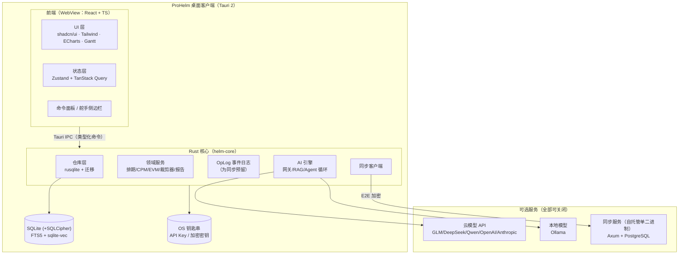
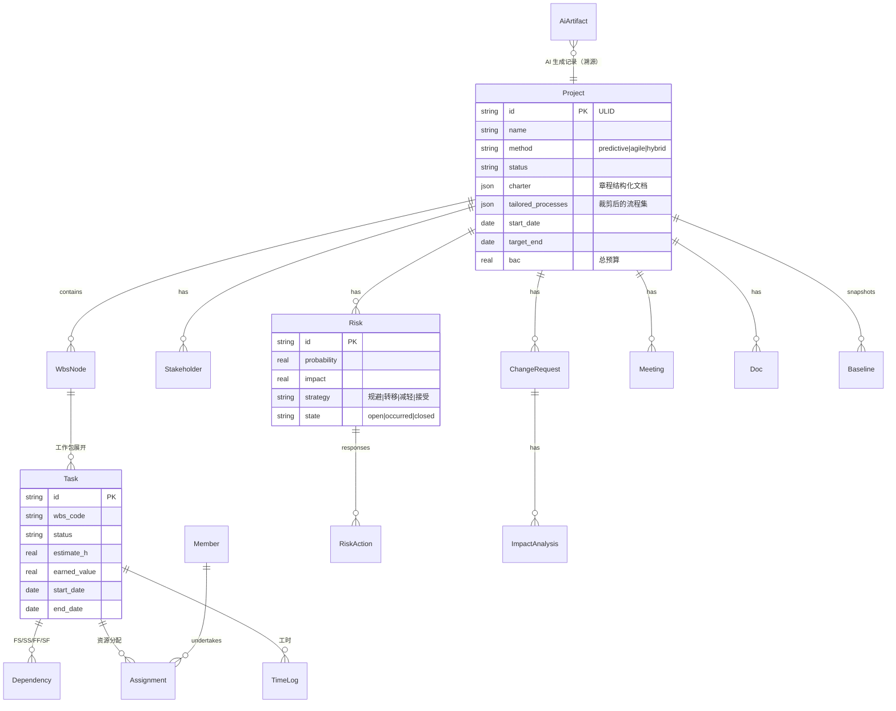
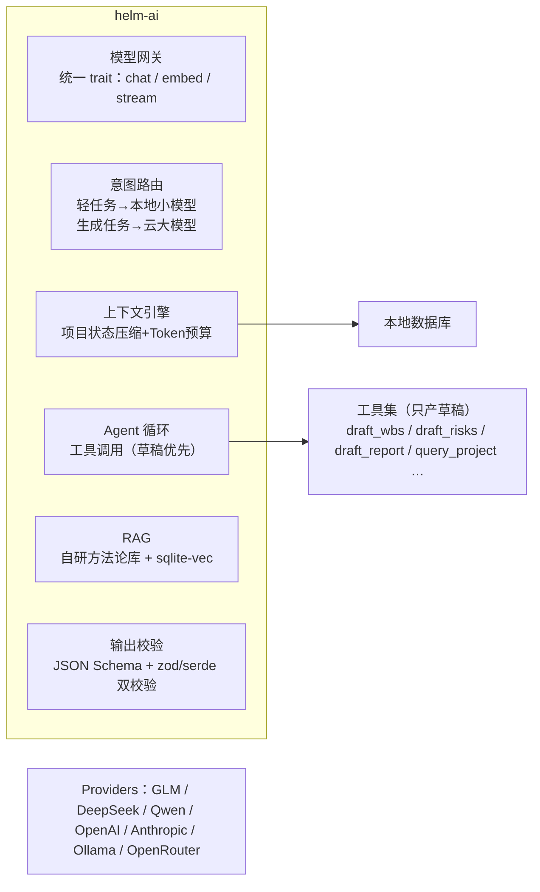

# ProHelm（项舵）技术选型与架构设计

> 版本：v0.1（初稿）｜日期：2026-11-14
> 前置文档：《01-市场调研》《02-产品功能设计》

---

## 1. 选型原则

按产品定位（**桌面端 · 本地优先 · AI 原生 · 小团队研发可维护**）推导五条原则：

1. **轻**：安装包 <30MB、空闲内存 <150MB——项目管理工具应该是常驻而非性能怪兽
2. **本地优先**：SQLite 为唯一事实源；联网能力（AI/同步）全部可降级
3. **隐私内生**：加密、脱敏、密钥管理是架构组件，不是功能补丁
4. **小团队可维护**：单人/双人研发也能推进——优先生态成熟、类型统一（TS + Rust 双端但边界清晰）、避免自研重轮子
5. **演进友好**：M1 单机 → M3 协作的路径在架构上一开始就预留（oplog/事件日志），不做推倒重来

---

## 2. 总体架构

关键决策：**业务逻辑与数据全部在 Rust 核心层**，前端只做渲染与交互——保证未来加移动端/CLI/MCP 时核心可复用。

---

## 3. 桌面框架：Tauri 2.x（选型结论：Tauri，不用 Electron）

### 3.1 对比

| 维度 | Tauri 2.x | Electron |
|---|---|---|
| 安装包 | **1~15MB**（系统 WebView + Rust 静态链接） | 85~106MB+（内置 Chromium） |
| 空闲内存 | **30~40MB 起**（实测部分场景与 Electron 接近） | 150~300MB |
| 后端语言 | **Rust**（性能好，适合 CPM 排期/EVM 计算/加密） | Node.js |
| 系统集成 | 原生托盘/通知/自更新/单实例/深链（官方插件齐全） | 成熟、社区方案更多 |
| 渲染一致性 | 依赖系统 WebView（Win=WebView2，mac=WKWebView，Linux=webkitgtk） | **内置 Chromium，三端一致** |
| 生态 | 较小但增长快，v2 已稳定、支持移动端 | 最成熟 |
| 学习曲线 | 需要 Rust 能力 | 前端团队几乎零门槛 |

数据来源见《01-调研报告》附录（OpenReplay 2025 对比、社区基准）。

### 3.2 判断与风险缓解

- Windows 目标用户（国内为主）的 WebView2 由系统自动分发预装，一致性风险最大的 Linux 反而不是目标平台 → 可接受
- 需要的 Rust 能力集中在数据层与算法层，边界清晰，可由 1 名 Rust 工程师承担
- 若团队 Rust 储备为零且需快速验证 MVP，**备选方案是 Electron**（架构分层不变，仅核心层换成 Node；数据层接口保持抽象）——按团队现状二选一，本文按 Tauri 继续

---

## 4. 前端技术栈

| 关注点 | 选型 | 版本基线 | 理由 |
|---|---|---|---|
| 框架 | **React + TypeScript** | React 19 / TS 5.x | 生态最大，甘特/看板类组件供给充足；严格模式开启 |
| 构建 | Vite | Vite 6+ | Tauri 官方推荐路径 |
| UI 组件 | **shadcn/ui + Tailwind CSS** | Tailwind v4 | 代码归用户所有、可深度定制、无运行时主题包袱 |
| 状态管理 | **Zustand**（UI 态）+ **TanStack Query**（服务/命令态） | v5/v6 | 轻量、类型友好；本地数据读写走 Rust 命令后统一用 Query 缓存 |
| 路由 | React Router（hash 路由） | v7 | 桌面单窗口，路由简单 |
| 图表 | **Apache ECharts** | 5.x/6.x | S 曲线/雷达/热力图全覆盖，中文文档好 |
| 甘特图 | 见 4.1 专节 | — | 核心差异化组件，需重点决策 |
| 看板/拖拽 | **dnd-kit** | v6 | 无障碍、多容器、类型好 |
| 富文本/文档 | **Tiptap** | 2.x/3.x | 基于 ProseMirror，Markdown 双向、可嵌入 AI 行内生成 |
| 表格 | TanStack Table | v8 | 无头、可控 |
| 表单 | react-hook-form + zod | — | 与 AI 结构化输出共用 zod schema |
| 图标 | lucide-react | — | 轻量统一 |

### 4.1 甘特图选型（专项）

甘特图是"预测型/混合型"用户的核心体验，需求：依赖类型（FS/SS/FF/SF）、关键路径高亮、拖拽改期、里程碑、资源泳道。

| 方案 | 许可 | 能力 | 评估 |
|---|---|---|---|
| **Frappe Gantt** | MIT | 基础甘特 + 依赖 | M1 够用；无关键路径/复杂依赖 |
| gantt-task-react 等 | MIT | 基础 | 同上，社区维护一般 |
| **dhtmlxGantt** | 商业（GPL 双许可） | 关键路径/依赖完整/成熟 | 有 GPL 污染风险，闭源商用需授权费 |
| **Bryntum Gantt** | 商业 | 能力最强（CPM/资源/基线），React 原生支持 | 约 $2k+/开发者授权，质量高 |
| 自研（SVG/Canvas） | — | 完全可控 | 工作量 2~3 人月起步，长尾细节多 |

**推荐路径**：M1 用 **Frappe Gantt + 自研关键路径计算层**（CPM 在 Rust 领域层实现，前端仅渲染高亮——算法是自己的，组件先用现成的）；M2 若确认产品方向，评估 **Bryntum 商业授权**（一次性成本换 3~6 人月研发）。这个组合避免了"为验证期买重型授权"和"为成熟期自研无限细节"两个极端。

---

## 5. 数据层

### 5.1 本地存储

| 关注点 | 选型 | 说明 |
|---|---|---|
| 数据库 | **SQLite**（rusqlite，Rust 侧直连） | 单文件、零运维、事务完整；不走 tauri-plugin-sql（避免高频 IPC 查询），前端通过类型化命令获取数据 |
| 加密 | **SQLCipher**（rusqlite `bundled-sqlcipher` feature） | 可选整库加密，密钥存 OS 钥匙串 |
| 全文检索 | **FTS5**（中文分词用 `simple` tokenizer 或 jieba 分词预索引） | 文档/任务搜索 |
| 向量检索 | **sqlite-vec** | 方法论知识库 RAG、语义搜索 |
| 迁移 | refinery 或自研版本化迁移 | 迁移脚本进版本控制 |
| 备份 | 每日快照 + WAL checkpoint；快照可选加密 | 崩溃恢复 + 时间旅行 |

### 5.2 数据模型草案（核心实体）

设计要点：

- **ULID 主键**：离线创建不冲突，天然可排序（为同步与 oplog 打基础）
- **`json` 字段存结构化工件**（章程/裁剪配置）：用 zod（前端）+ serde（Rust）共享 schema 校验，兼顾灵活与类型安全
- **Baseline 表**：存计划基线快照，EVM 的 PV 与偏差计算依赖它
- **AiArtifact 表**：每次 AI 生成记录（输入摘要/模型/依据/采纳状态），支撑"可溯源、可撤销"
- **OpLog 表**：所有写操作追加事件（实体/操作/载荷/设备/时钟），M1 就写入——M3 同步引擎直接消费，避免事后补日志

---

## 6. AI 架构（AI 原生的技术实现）

### 6.1 AI 引擎分层（Rust 侧实现，IPC 暴露给前端）

### 6.2 关键设计决策

| 决策 | 结论 | 理由 |
|---|---|---|
| **BYOK** | 默认用户自带 Key，支持 GLM/DeepSeek/Qwen/OpenAI/Anthropic/Ollama/OpenRouter；Pro 版可订阅平台统一额度 | 零 AI 成本启动、合规简单、国内模型可访 |
| Key 保管 | OS 钥匙串（`keyring` crate：Win 凭据管理器/macOS Keychain/Linux Secret Service） | 不落盘明文 |
| 生成范式 | **一切工具只产草稿（draft），不直接写库**；前端呈现 diff，用户采纳后才调用写命令 | 对应产品铁律"AI 永远要确认"；审计简单 |
| 结构化输出 | JSON Schema / Tool-call 强约束 + 双端 schema 校验 + 失败自动重试降级 | WBS/风险登记册等必须结构化入库 |
| 方法论问答 | **自研撰写**的 PMP 知识库（~500 条目：概念/工具/ITTO 摘要/场景），bge-small-zh 本地嵌入 + sqlite-vec 检索，LLM 受控生成 | 规避 PMBOK 原文版权；离线可答概念题 |
| 轻任务本地化 | 分类/打标/摘要用本地小模型（Ollama 或内嵌 fastembed/bge），生成类才走云端 | 省钱 + 离线体验 |
| 预测置信度 | L3 输出统一带 confidence 字段；<阈值只展示不推送通知 | 对应"置信度透明"铁律 |
| Token 成本 | 上下文压缩（项目摘要 + 检索切片，非全量注入）；Prompt 缓存；用量面板 | 中小团队对成本敏感 |
| 未来生态 | 客户端暴露只读 **MCP Server**（本地 stdio），用户可在 Claude/ZCode 等外部 AI 里查询自己的项目数据 | AI 原生叙事的放大器，成本低 |

---

## 7. 同步与协作方案（M3，但 M1 铺路）

### 7.1 候选对比

| 方案 | 模式 | 优点 | 缺点 |
|---|---|---|---|
| A. 无同步（文件包导入导出） | 单机 | 零成本、零风险 | 团队协作弱，M1 现实选择 |
| B. **自研 OpLog 同步**（Rust Axum 服务 + E2E 加密） | 中央权威 + 事件回放 | 完全掌控、单二进制自托管贴合目标客户、可按域做合并策略 | 研发投入约 2~3 人月，冲突合并要精做 |
| C. cr-sqlite（CRDT SQLite 扩展） | P2P/多主 | 理论优雅、真离线多主 | 项目维护活跃度有不确定性、调试复杂 |
| D. PowerSync / ElectricSQL | 服务端权威（Postgres↔SQLite） | 成熟、文档好 | 强制 Postgres 后端 + 服务端可读明文，违背"端到端加密、服务端无法读取"卖点；授权模式需评估 |

### 7.2 推荐路线

1. **M1**：方案 A。JSON 加密包导入导出 + "项目文件夹"（Git-friendly），先验证产品
2. **M3**：**方案 B 自研轻量 OpLog 同步**：
   - 结构化实体标量字段用 **LWW（最后写入胜出）**；列表/文档类（WBS 树、文档）用 **按节点子树合并**
   - 同步服务端只存储加密块（XChaCha20-Poly1305，workspace 密钥在客户端密钥协商），**服务端无法读取内容**
   - 支持官方云托管（Pro/Team 订阅）与**单二进制自托管**（企业版）双形态
   - 若后续需要多人实时协同编辑文档，局部引入 **Yjs**（仅文档域），不全局 CRDT 化

> 取舍说明：放弃 D 是因为它与"数据主权"这一核心卖点冲突；放弃 C 是工程可控性优先。自研 B 的复杂度集中在合并策略，通过 M1 的 OpLog 打底可显著降低风险。

---

## 8. 安全与隐私

| 层 | 措施 |
|---|---|
| 本地数据 | 可选 SQLCipher 整库加密；密钥派生自设备口令 + OS 钥匙串 |
| AI 外发 | 默认脱敏（项目名/人名/客户名 → 代号）；可配置"允许外发字段白名单"；外发前预览界面（敏感项红色标注） |
| 同步 | E2E 加密，密钥仅存在于用户设备；设备配对与吊销 |
| 审计 | 全量本地操作日志（含 AI 采纳记录），可导出 |
| 遥测 | 默认关闭，opt-in 且匿名化（区分"诊断数据"与"使用统计"两层） |
| 更新 | tauri-updater + 签名校验 + 增量更新 |

---

## 9. 工程化

| 关注点 | 方案 |
|---|---|
| 仓库结构 | Monorepo：`apps/desktop`（Tauri+React）、`crates/core|ai|sync`（Rust）、`packages/shared-schema`（zod/TS 与 Rust 类型对齐，用 `schemars` 生成 JSON Schema 作为单一事实源） |
| 包管理 | pnpm workspace + Cargo workspace |
| CI | GitHub Actions：rustfmt/clippy + eslint/typos → 测试 → 三平台构建（Win/mac/Linux）→ 自动签名 → Draft Release |
| 测试 | Rust 单测（CPM/EVM/合并算法 100% 覆盖）+ vitest（前端逻辑）+ Tauri WebDriver 少量 E2E + 真机三平台手测清单 |
| 质量 | 核心算法（关键路径/EVM/资源冲突）用黄金用例集做快照测试 |
| 发布 | tauri-updater 自动更新 + 更新日志内嵌 |
| 观测 | 本地日志文件（分级）+ 可选 Sentry（自托管兼容） |

---

## 10. 技术风险清单

| 风险 | 等级 | 缓解 |
|---|---|---|
| Rust 核心层研发门槛 | 高 | 边界收敛在数据/算法/AI 三层；招 1 名 Rust 工程师或创始人自研；UI 层保持纯 TS |
| 甘特图体验达不到 MS Project 水准 | 高 | M1 降低预期（Frappe+自研 CPM），M2 商业授权 Bryntum；绝不 UI 半成品出门 |
| 自研同步的冲突合并复杂度 | 中高 | M1 OpLog 打底；MVP 只做单用户多设备同步（简单），团队共享做增量灰度 |
| AI 供应商 API 差异/不稳定 | 中 | 网关统一抽象 + 每供应商适配器 + 降级链（云→备用云→本地） |
| sqlite-vec 等新兴库成熟度 | 中 | 用法收敛（只做 KNN 检索），可替换为 SQLite VSS/纯 JS 方案 |
| WebView 差异（Linux/老 Windows） | 低 | 目标平台聚焦 Win10+/macOS；Linux 标记为社区支持 |

---

## 11. 里程碑与技术交付对照

| 产品里程碑 | 技术交付 |
|---|---|
| M1（0~3 月） | Tauri 骨架、rusqlite+迁移+OpLog、任务/WBS/甘特（Frappe+CPM）、风险登记册、AI 网关（BYOK+流式+草稿流）、PMP 教练 RAG v1、备份导出、三平台 CI |
| M2（3~6 月） | EVM 引擎与基线、变更控制流、工时/资源负荷、舵手 L2/L3（生成器面板+体检任务）、sqlite-vec 语义检索、PDF 报告、甘特图升级评估（Bryntum） |
| M3（6~9 月+） | 同步服务（Axum 单二进制+E2E）、角色权限、伴侣端 App（Tauri 2 移动）、集成（日历/IM/Git）、MCP Server、插件接口 |

---

## 12. 结论

- **桌面框架**：Tauri 2.x（备选 Electron，按团队 Rust 储备定夺）
- **前端**：React 19 + TS + shadcn/ui + Tailwind + ECharts + dnd-kit + Tiptap
- **核心/数据**：Rust（rusqlite + SQLCipher + FTS5 + sqlite-vec）+ OpLog 事件打底
- **AI**：BYOK 多模型网关 + 草稿优先 Agent + 自研方法论 RAG + OS 钥匙串
- **同步（M3）**：自研轻量 OpLog 同步服务（E2E 加密、可自托管），明确不用 PowerSync/ElectricSQL（与服务端可读模型冲突）
- **甘特**：Frappe Gantt + 自研 CPM 起步，商业授权按产品验证结果升级

这套组合在"轻量本地优先"与"小团队可维护"之间取得了平衡，且每一步都为下一步（单机→同步→生态）预留了架构接口。

---

*配套文档：《01-市场调研与PMP体系梳理》《02-产品功能设计》*
